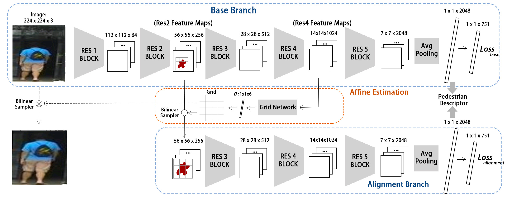
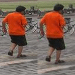
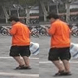
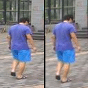
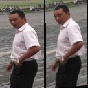

# Pedestrian Alignment Network for Person Re-identification

This repo is for our IEEE TCSVT paper 

[[10min Intro Youtube]](https://www.youtube.com/watch?v=OJR43TzS3a8&t=41s&ab_channel=IEEETransonCircuits%26SystemforVideoTech)

(ArXiv Link: https://arxiv.org/abs/1707.00408 IEEE Link: https://ieeexplore.ieee.org/document/8481710). 

The main idea is to align the pedestrian within the bboxes, and reduce the noisy factors, i.e., scale and pose variances.

## Network Structure

For more details, you can see this [png file](https://raw.githubusercontent.com/layumi/Pedestrian_Alignment/master/PAN.png). But it is low-solution now, and I may replace it recently.

## Installation
1.Clone this repo.

    git clone https://github.com/layumi/Pedestrian_Alignment.git
    cd Pedestrian_Alignment
    mkdir data

2.Download the pre-trained model. Put it into './data'.

    cd data
    wget http://www.vlfeat.org/matconvnet/models/imagenet-resnet-50-dag.mat
    
3.Compile Matconvnet
**(Note that I have included my Matconvnet in this repo, so you do not need to download it again. I have changed some codes comparing with the original version. For example, one of the difference is in `/matlab/+dagnn/@DagNN/initParams.m`. If one layer has params, I will not initialize it again, especially for pretrained model.)**

You just need to uncomment and modify some lines in `gpu_compile.m` and run it in Matlab. Try it~
(The code does not support cudnn 6.0. You may just turn off the Enablecudnn or try cudnn5.1)

If you fail in compilation, you may refer to http://www.vlfeat.org/matconvnet/install/
    
## Dataset
Download [Market1501 Dataset](http://www.liangzheng.org/Project/project_reid.html). [[Google]](https://drive.google.com/file/d/0B8-rUzbwVRk0c054eEozWG9COHM/view) [[Baidu]](https://pan.baidu.com/s/1ntIi2Op)

For training CUHK03, we follow the new evaluation protocol in the [CVPR2017 paper](https://github.com/zhunzhong07/person-re-ranking). It conducts a multi-shot person re-ID evaluation and only needs to run one time.

## Train
1. Add your dataset path into `prepare_data.m` and run it. Make sure the code outputs the right image path.

2. uncomment https://github.com/layumi/Pedestrian_Alignment/blob/master/resnet52_market.m#L23 

Run `train_id_net_res_market_new.m` to pretrain the base branch.

3. comment https://github.com/layumi/Pedestrian_Alignment/blob/master/resnet52_market.m#L23 

Run `train_id_net_res_market_align.m` to finetune the whole net.

## Test
1. Run `test/test_gallery_stn_base.m` and `test/test_gallery_stn_align.m` to extract the image features from base branch and alignment brach. Note that you need to change the dir path in the code. They will store in a .mat file. Then you can use it to do the evaluation.

2. Evaluate feature on the Market-1501. Run `evaluation/zzd_evaluation_res_faster.m`. You can get a Single-query Result around the following result.

| Methods               | Rank@1 | mAP    | 
| --------              | -----  | ----   | 
| Ours           | 82.81% | 63.35% | 

You may find our trained model at [GoogleDrive](https://drive.google.com/open?id=1X09jnURIicQk7ivHjVkq55NHPB86hQT0)
## Visualize Results
We conduct an extra interesting experiment:
**When zooming in the input image (adding scale variance), how does our alignment network react?**

We can observe a robust transform on the output image (focusing on the human body and keeping the scale).

The left image is the input; The right image is the output of our network.


    
    



    
    


## 🔗 Related Projects

<p align="center"><i>Explore our ecosystem for Object Re-Identification 🔍</i></p>

<div align="center">
  <table>
    <tr>
      <td align="center" colspan="3">
        <a href="https://github.com/layumi/Person_reID_baseline_pytorch">
          <h3>⛹️</h3>
          <b>Person re-ID Baseline (PyTorch)</b>
        </a>
        <br><sub>A <b>Tiny, Friendly & Strong</b> PyTorch Baseline for Person / Vehicle Re-ID<br>with Hands-on Tutorial · The Community Standard since 2017</sub>
        <br><br>
        <a href="https://github.com/layumi/Person_reID_baseline_pytorch"></a>
      </td>
    </tr>
    <tr>
      <td align="center" width="33%">
        <a href="https://github.com/layumi/3D-Magic-Mirror">
          <h3>🪞</h3>
          <b>3D Magic Mirror</b>
        </a>
        <br><sub>Clothing Reconstruction from a Single Image<br>via a Causal Perspective · npj AI'26</sub>
        <br><br>
        <a href="https://github.com/layumi/3D-Magic-Mirror"></a>
      </td>
      <td align="center" width="33%">
        <a href="https://github.com/NVlabs/DG-Net">
          <h3>✨</h3>
          <b>DG-Net</b>
        </a>
        <br><sub>Joint Generation + Re-ID Learning<br>CVPR'19 Oral · NVIDIA</sub>
        <br><br>
        <a href="https://github.com/NVlabs/DG-Net"></a>
      </td>
      <td align="center" width="33%">
        <a href="https://github.com/layumi/Person-reID_GAN">
          <h3>🎨</h3>
          <b>Person re-ID GAN</b>
        </a>
        <br><sub>GAN-based Augmentation (LSRO)<br>ICCV'17</sub>
        <br><br>
        <a href="https://github.com/layumi/Person-reID_GAN"></a>
      </td>
    </tr>
    <tr>
      <td align="center" width="33%">
        <a href="https://github.com/layumi/Image-Text-Embedding">
          <h3>📝</h3>
          <b>Language Person Search</b>
        </a>
        <br><sub>Text-based Person Retrieval<br>Dual-Path Embedding</sub>
        <br><br>
        <a href="https://github.com/layumi/Image-Text-Embedding"></a>
      </td>
      <td align="center" width="33%">
        <a href="https://github.com/Shuyu-XJTU/APTM">
          <h3>🏷️</h3>
          <b>APTM</b>
        </a>
        <br><sub>Attribute Prompt Learning &amp; Text Matching<br>MALS Benchmark (1.5M pairs) · ACM MM'23</sub>
        <br><br>
        <a href="https://github.com/Shuyu-XJTU/APTM"></a>
      </td>
      <td align="center" width="33%">
        <a href="https://github.com/Shuyu-XJTU/CMP">
          <h3>🚨</h3>
          <b>CMP</b>
        </a>
        <br><sub>Text-based Person <b>Anomaly</b> Search<br>PAB Benchmark (1M pairs) · ICCV'25 <b>Highlight</b></sub>
        <br><br>
        <a href="https://github.com/Shuyu-XJTU/CMP"></a>
      </td>
    </tr>
    <tr>
      <td align="center" width="33%">
        <a href="https://github.com/layumi/person-reid-3d">
          <h3>🧊</h3>
          <b>3D Person re-ID</b>
        </a>
        <br><sub>Parameter-Efficient Re-ID<br>in the 3D Space (OG-Net)</sub>
        <br><br>
        <a href="https://github.com/layumi/person-reid-3d"></a>
      </td>
      <td align="center" width="33%">
        <a href="https://github.com/layumi/Pedestrian_Alignment">
          <h3>🚶</h3>
          <b>Pedestrian Alignment</b>
        </a>
        <br><sub>Pedestrian Alignment Network (PAN)<br>for Robust Re-ID</sub>
        <br><br>
        <a href="https://github.com/layumi/Pedestrian_Alignment"></a>
      </td>
      <td align="center" width="33%">
        <a href="https://github.com/layumi/2016_person_re-ID">
          <h3>🔁</h3>
          <b>2-Stream Person re-ID</b>
        </a>
        <br><sub>Verification + Identification<br>Baseline</sub>
        <br><br>
        <a href="https://github.com/layumi/2016_person_re-ID"></a>
      </td>
    </tr>
  </table>
</div>

---

<p align="center">
  ⭐ If you find our projects helpful, a <b>star</b> is the best support! ⭐
</p>

## Citation
Please cite this paper in your publications if it helps your research:
```
@article{zheng2017pedestrian,
  title={Pedestrian Alignment Network for Large-scale Person Re-identification},
  author={Zheng, Zhedong and Zheng, Liang and Yang, Yi},
  doi={10.1109/TCSVT.2018.2873599},
  note={\mbox{doi}:\url{10.1109/TCSVT.2018.2873599}},
  journal={IEEE Transactions on Circuits and Systems for Video Technology},
  year={2018}
}
```

## Acknowledge
Thanks for the suggestions from Qiule Sun.
